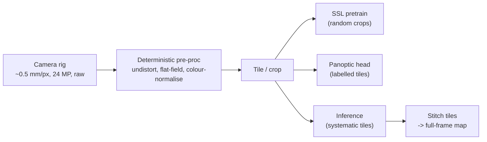

# MeshWatch — Compute & Data Pipeline

Last Updated: 2026-09-19

## Overview

These are working notes on the practical side of the perception plan: capture resolution, pre-processing, tiling, and the GPU and storage cost of training. The aim is to reason through the trade-offs rather than hand down a spec.

It sits as the practical layer beneath the perception plan — a look at what the camera produces, what happens to those pixels before the model sees them, and what hardware trains and runs the model. The processing chain is largely the same at training and deployment. The main difference is that training adds random augmentation, while inference adds systematic tiling with stitching.



## Capture resolution (GSD)

A useful way to frame resolution is as ground sampling distance (GSD) — millimetres per pixel at the wall — rather than megapixels. On that view the capture-rig spec's ~0.5 mm/px looks like the right target, and it is corrosion grading rather than detection that drives the number.

A few observations sit behind that:

- Distinction between GSCI 3 (pitting/flaking) and GSCI 2 comes down to resolving 1-3 mm features. At 0.5 mm/px a 2-3 mm pit spans 4-6 px, around the minimum for reliable texture classification. Mesh wire (~5-6 mm), plates (~150 mm) and rockfall are far coarser, so they come essentially for free.
- There seems little to gain from over-speccing. 0.2 mm/px roughly quadruples pixels, storage and compute for a marginal grading gain, which leaves 0.5 mm/px looking like the sweet spot, with 0.3-0.4 as a stretch for the finest pitting.
- Colour appears to matter (rust is a colour signal), as does global shutter (rolling shutter warps mesh and disrupts stereo), and 10-12-bit raw preserves dynamic range for the shadowed band in this high-contrast scene.

The consequence worth holding onto is that **camera resolution and model input resolution are decoupled.** A ~24 MP frame never enters the network whole: the camera captures at 0.5 mm/px for grading fidelity, and the model consumes tiles. That split is what the tiling section explores.

## Pre-processing

It seems cleanest to think of pre-processing as two separate buckets, since conflating them is a classic source of train/deploy skew.

The first is deterministic — the same operations on every image, in both training and inference:

- Lens undistortion and stereo rectification from calibration. This is needed for the geometry track, and it also brings appearance consistency.
- Flat-field / vignette correction. This looks like the highest-value step, and a cheap one, because the lights are controlled: the fixed illumination field can be calibrated once and divided out. It addresses the bright-foreground / black-falloff problem at source rather than amplifying noise.
- Colour normalisation from the in-frame grey/colour target, so the corrosion grader keys on rust rather than the colour cast of the light.
- Tiling into patches (discussed next).

A reasonable stance is to version this pipeline and treat it as part of the model, since changing any of these parameters implies retraining.

The second is train-time only — stochastic augmentation that never runs at inference: brightness/contrast jitter, motion-blur, mild noise, flips, cutout. The point of it is robustness to the drive-by channel.

Two things look worth steering clear of. One is baking heavy irreversible enhancement (aggressive CLAHE, sharpening, tone-mapping) into training data, since it creates artifacts that then have to be reproduced exactly at inference. The other is pre-processing the unlit band; masking it to the ignore class seems the better option. In general, fixing appearance at capture (more light, cross-polarisation) looks preferable to fixing it in software.

## Tiling, explained from scratch

**The problem.** A 24 MP frame is 6000x4000 = 24 million pixels, which cannot feed into a backbone directly. Memory blows up (a ViT would turn it into hundreds of thousands of tokens), and pretrained backbones expect small inputs (224-1024 px). That leaves two ways to shrink a big image to something a network can consume.

**Option A — downscale the whole frame.** Resizing 6000x4000 down to 1024x683 is cheap and simple, but it destroys fine detail: a 3 mm corrosion pit that was 6 px at 0.5 mm/px shrinks about 6x, to roughly 1 px, and is gone. That suits coarse questions (is there mesh on this wall?) but not corrosion grading.

**Option B — tile (crop) the full-res frame.** Here a window slides across the full-resolution image, cutting it into a grid of smaller patches ("tiles"); each tile runs through the model at full resolution, and the outputs are recombined. Detail survives because each tile is native resolution, which is why this is the usual approach for anything fine-grained.

So tiling is, in essence, processing a big image as a grid of small full-res crops.

Three parameters govern it:

- **Tile size** (e.g. 1024x1024) is the patch the model sees. A bigger tile means more context and more GPU memory; a smaller one is cheaper but carries less context.
- **Overlap** (e.g. 128-256 px) is the margin neighbouring tiles share, so an object on a tile edge is not cut in half and predictions can be blended across the seam.
- **Stride** = tile size - overlap is how far the window moves each step.

The tile count per frame is the compute multiplier:

```latex
N_{tiles} = \left\lceil \frac{W - T}{S} + 1 \right\rceil \times \left\lceil \frac{H - T}{S} + 1 \right\rceil
```

For W=6000, H=4000, tile T=1024, overlap 256 (so stride S=768), that is about 8 x 5 = ~40 tiles per frame. One 24 MP frame therefore costs ~40 forward passes at inference, which is worth accounting for.

Training and inference need not tile the same way:

- **SSL pretraining** does not need full coverage. A few random full-res crops per frame each epoch work as augmentation — different crops each pass, cheap, effectively free tiling — and the backbone never sees the whole frame.
- **Panoptic head training** tiles the labelled frames into patches with their mask crops. Sampling crops around annotated regions rather than uniformly seems to matter here: uniform crops on a mostly-sound drive yield thousands of background tiles and starve the rare classes (rockfall, torn mesh).
- **Inference** is where full systematic coverage matters. The window slides over the whole frame with overlap, every tile runs, and the per-tile predictions are stitched into one full-frame map.

Stitching the predictions back raises a couple of cases:

- **Classes (mesh, fibrecrete, rock):** in the overlap regions, averaging the per-class probabilities (logits) from the overlapping tiles and then taking argmax avoids visible seams; a hard argmax per tile, then paste, tends to create them.
- **Instances (plates, bolts):** harder, because a plate split across two tiles becomes two half-detections that have to be merged (by IoU / NMS across tile boundaries). The SAHI library (Slicing Aided Hyper Inference) handles tiled inference and instance-merging, which seems preferable to writing a custom one.
- **Bookkeeping:** every tile carries its (x, y) offset in the full frame, and predictions are placed back by that offset, so a per-tile manifest is worth keeping.

Tiling is not always necessary. Phase-1 surface segmentation (mesh / fibrecrete / rock extents) tolerates downscaling, since region boundaries do not need 0.5 mm/px; it could run on a downscaled ~1536 px frame and skip tiling entirely. Full-res tiling is best kept for corrosion and the fine Phase-2/3 work, where the small features live. This mirrors the labelling guidance: surfaces at reduced resolution, corrosion at full resolution.

One more practical angle: many tiles are mostly the unlit/void band. Detecting them (a brightness or entropy threshold) and skipping them at inference saves compute, and void pixels can be masked out of the loss during training.

## Compute & GPUs

Three jobs, with very different appetites. The honest headline is that only domain SSL is likely to want a multi-GPU node.

| Job | Minimum to start | Comfortable | When you need more |
| --- | --- | --- | --- |
| v1: off-the-shelf backbone + head | 1x 24 GB (RTX 4090) | 1x 48 GB (L40S) | — |
| Panoptic head training | 1x 24 GB | 1x 48–80 GB (A100) | multi-GPU only for large crops/batch or faster iteration |
| Domain SSL pretraining | 1x A100 40–80 GB | 2x A100/H100 | 8x H100/B200 node for a large backbone on a large corpus, fast wall-clock |

A few sizing drivers make the picture less of a guess:

- **Mask2Former is memory-bound by input (tile) resolution and query count,** since it carries high-res mask features through a transformer decoder. 24 GB fits small tiles and batches; 48–80 GB is what opens up the larger tiles fine corrosion needs. Head training on a few hundred labelled frames is a matter of hours on one card.
- **SSL is memory-bound by batch size and image size.** Self-distillation likes large effective batches, so 40–80 GB helps, and gradient accumulation substitutes when the batch does not fit. On ~10k frames, a ViT-S/B for a few hundred epochs is roughly a day on 1–2 A100/H100; a ViT-L, or a much larger corpus, is where an 8-GPU node starts to earn its place.
- **Off-the-shelf DINOv2/v3 needs essentially no SSL compute** — a single card for feature extraction. That is the reason v1 leans on it and defers the one expensive part until the pipeline is proven.

On the bursty part, renting looks more sensible than buying. SSL pretraining amounts to a few days of 1–8 GPUs, a handful of times, which fits an 8x H100/B200 node rented by the hour (Lambda, RunPod, or the existing AWS/GCP EKS GPU pools). One owned or persistent 48 GB card covers day-to-day head-training iteration. Buying a node only pays off once pretraining runs continuously, and exact instance types and prices move, so they are worth checking at purchase time.

Indicative on-demand prices (in USD) turn the sizing above into a rough budget. The figures below are per GPU, per hour, from services such as Lambda Labs and RunPod, as of September 2026. Each is a range because it spans community and secure-cloud tiers. On-demand rates move often, and reserved or committed-use pricing runs lower, so these are best treated as a starting point rather than a quote.

| GPU (memory) | Indicative on-demand $/GPU-hr | Where it fits |
| --- | --- | --- |
| RTX 4090 (24 GB) | ~$0.75 | Cheapest v1 and head-training card |
| L40S (48 GB) | ~$1.10 | Comfortable single-card head training |
| A100 (40–80 GB) | ~$1.20–2.00 | SSL on 1–2 cards; the larger tiles fine corrosion needs |
| H100 (80 GB) | ~$2.00–4.30 | Faster SSL; community tiers low, on-demand SXM high |
| B200 | ~$6.70–7.00 | A large backbone on a large corpus |

For a sense of scale: a three-day burst on an 8x H100 node at roughly $3/GPU-hr is on the order of $1,700 (8 x $3 x 72 h). A handful of such bursts stays well below the cost of owning a node.

Deployment is a separate sizing question. The rig's onboard inference (Jetson Orin class, per the capture-rig spec) runs a distilled edge model rather than these training GPUs, and is best budgeted separately at Phase 2.

## Storage, throughput & connections

Capture volume is set by resolution x frame-rate x stereo x drive length. A 24 MP frame is roughly 15–40 MB, depending on raw versus compressed and bit depth, and a stereo pair doubles it. A survey pass at a few frames per second over a drive quickly reaches tens of GB, which points to on-vehicle NVMe plus a tiered offload path (the capture-rig spec's onboard capture and live QC). Compressing raw losslessly and keeping the colour target frame with each pass supports the pre-processing step.

Materialising tiles to disk looks worth avoiding, since pre-cutting every frame into ~40 tiles multiplies storage ~40x. Tiling on-the-fly at data-load time (a crop in the dataloader) works unless the job is I/O-bound; the full-res frames stay the source of truth, and tiles can be treated as ephemeral.

Two numbers seem worth tracking as the corpus grows: unlabelled frames (which feed SSL, where more diversity helps) and labelled frames (which feed the head, the bottleneck). They scale independently.

Where this connects:

- Model plan and architecture: the companion doc linked at the top.
- The SSL and head training steps in detail: [MeshWatch — SSL Pretraining & Panoptic Head: Getting Started](https://claude.ai/code/artifact/8b56de2b-e588-41ce-8f6e-051d93999a44).
- How the labelled tiles are produced: [MeshWatch — Phase-1 Labelling Approach](https://claude.ai/code/artifact/3611baa0-5a4a-4287-bd3a-942a07ec47bb).
- Sensor, lighting and stereo details: the `capture-rig-camera-spec` project doc.
