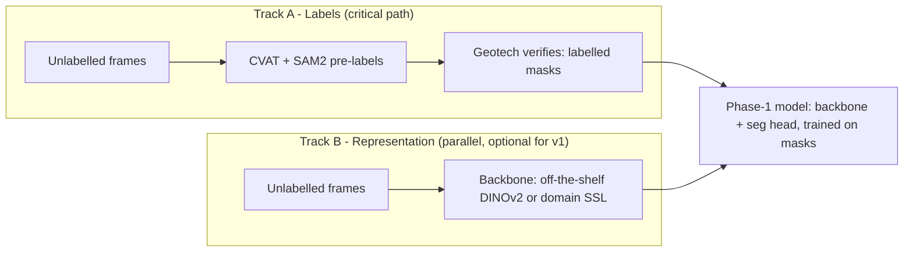
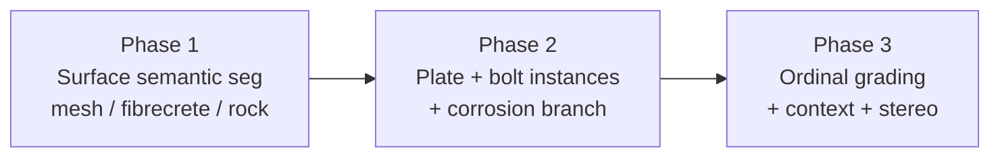

# MeshWatch — Perception Model Recommendation

Last Updated: 2026-09-19

## Scope & recommendation

These are working notes on the perception model, coming out of a review of the Mount Isa drive imagery: 45 DSLR frames (24 MP), plus phone stills and 8K drive-by video. This is the model-side companion to the capture-rig and Tier-B data-model docs.

The short version: it seems more useful to treat this as several models than as one. The six targets — mesh, fibrecrete, bolt types, corrosion in mesh, corrosion in bolts, other objects — are really three different geometric task types. The build that fits is a small multi-task perception stack on one shared, self-supervised backbone, delivered in phases. The first thing worth training is semantic segmentation of the surface classes.

## What is actually in the frames

These are hard-rock development drives (~5 x 5.5 m profile). Surfaces are bare rock, sprayed fibrecrete (fibres visible, with shrinkage and stress cracks), and weld mesh — bare over rock, or shotcreted over. Support elements resolve clearly at full 24 MP: diamond bolt plates (~150 mm), plate-plus-collar assemblies, cable-bolt ends, straps. A few concrete examples from the set:

- DSC_0325 — bare mesh, visibly bagged and torn, square weave crisp.
- DSC_0288 — fibrecrete, bolt plates and mesh in one frame.
- DSC_0313 — back covered in corroded bolt collars (orange rust blooms, run-down staining) plus white efflorescence (a water indicator).
- DSC_0397 — full fall-of-ground with exposed bolts and hanging mesh.

Confusers are everywhere: green vent bags, cables and services, reflective survey/convergence markers, spray-paint, vehicles, wet specular surfaces, dust.

The dominant image-quality problem looks like lighting rather than sharpness. A single moving light source gives a bright foreground band and hard black falloff, with specular hotspots on wet rock. The DSLR stop-and-shoot set is genuinely good; the drive-by video (8K but motion-blurred, with more occlusion) is materially worse. That is the gap the capture rig exists to close.

## The reframe: six targets, three task types

Mixing these into a single classifier is likely what capped the whole-frame MVP at ~0.5 AUC. Each target has a geometric nature that points to its task:

| Target | Nature | Right task |
| --- | --- | --- |
| Mesh, fibrecrete, rock, rockfall/muck, water/efflorescence, vent bag | amorphous "stuff" (no instances) | semantic segmentation |
| Bolts / plates (by type), cable ends, straps, vehicles, markers | countable "things" | instance detection / segmentation |
| Corrosion (in mesh / in bolts), mesh R0–R5, plate GSCI 0–4 | a condition on a region or instance | corrosion segmentation, then aggregate to an ordinal grade |

A key consequence: "corrosion in mesh" and "corrosion in bolts" do not need to be their own detectors. Corrosion is better treated as a per-pixel state layer — segment rust/stain pixels once, then intersect with the mesh mask and the plate/bolt instances. That matches how GSCI is defined (extent plus type of attack) and stays interpretable.

## Recommended architecture (north star)

Architecturally this converges on one multi-task network rather than a zoo of models:

- Shared backbone, self-supervised on unlabelled footage. This is probably the highest-ROI move: pretrain a DINOv2/MAE ViT (or continue-pretrain from DINOv2-L) on the thousands of video frames before any supervised head. It attacks domain gap and label scarcity at once.
- Panoptic segmentation head (Mask2Former-style) emitting the "stuff" classes (mesh / fibrecrete / rock / rockfall / water / vent-bag) and the "thing" instances (plates, cable ends) from the same features.
- Corrosion segmentation branch (clean / staining / active pitting-flaking), aggregated per element into a grade.
- Ordinal grading heads (CORAL / CORN or ordinal-aware loss) for mesh R0–R5 and plate GSCI 0–4, with calibrated uncertainty (temperature scaling / evidential) so the model can abstain-to-human.
- Later, the Tier-B context vector and stereo geometry (bag depth, spacing) can fuse in at the grading head.

An edge variant for the Jetson Orin rig would distill into a YOLO11-seg or RT-DETR for the "things" plus a light SegFormer for the "stuff." That is an optimization, not the first build.

### How the pieces sequence

Self-supervised pretraining is not a stage that finishes before labelling. It produces the shared backbone (one component of the network above) and needs only unlabelled frames. So labelling and representation can run as two parallel tracks that converge, and there is no need to gate labelling on SSL. For v1, a reasonable path is to start from off-the-shelf DINOv2 plus a few hundred labelled masks, run domain SSL in parallel, and fold it in for v2 only if it beats off-the-shelf on the validation set.

## What to train first

At MVP with no ground truth, starting with the full stack looks premature. Training semantic segmentation of the core surface classes first — mesh / fibrecrete / rock / rockfall / vent-bag / other — makes a good starting point. The reasoning, in order:

1. It is the substrate — plates, corrosion and grading all get scoped by these masks.
2. It addresses the known failure (the patch classifier false-triggering on rippled floor) via the mesh-region mask.
3. It is the most label-efficient to bootstrap: SAM2 mask proposals, a VLM for the class (extending the R-grade pseudo-labelling already done), and geotech verification. A few hundred verified frames should reach a usable v1.
4. It is honest for stakeholders — it is the deployed sliding-window detector's real form, not a proxy.

Phase 2 then adds plate/bolt instances plus the corrosion branch; Phase 3 adds ordinal grading, context fusion and stereo geometry.

For how to label the data for this phase (annotation type, scheme, tooling), see the companion doc: `MeshWatch — Phase-1 Labelling Approach`.

## How corrosion is handled

Corrosion is better treated as a condition layer than an object class. Two stages:

1. Segment corrosion pixels — binary, or 3-level (clean / staining / active pitting-flaking).
2. Intersect that mask with the mesh mask and each plate/bolt instance, giving a per-element corrosion coverage fraction plus morphology, then map to the ordinal GSCI 0–4 grade.

This produces "corrosion-on-mesh" and "corrosion-on-bolt" for free from a single corrosion model, mirrors the GSCI definition (extent plus type of attack), and keeps the output interpretable and auditable rather than a black-box per-element class.

## The parts that will actually be hard

- Labels are likely the bottleneck, not architecture. The model choice sits downstream of a foundation-model-assisted labelling pipeline (SAM2 + VLM + geotech verification) and grouped, leave-one-drive-out validation (the MVP already showed why grouping matters).
- Severe-grade scarcity. R4/R5 and GSCI 4 are rare, which points to the rig's "stop & stare" mode, copy-paste augmentation, and ordinal-aware loss.
- Resolution. Corrosion is best graded at full res, since the 1–3 mm pitting features live there. Tiling the 24 MP frames for train and inference and then stitching looks better than downscaling to fit a backbone.
- Lighting. Illumination normalization, heavy photometric augmentation, and a quality gate that abstains on the underexposed band all help. The train/deploy shift is worth noting: the rig's strobe lighting will be more uniform than this handheld set, so validating on rig-like data before trusting field numbers seems prudent.
- Bolt type is the weakest visual sub-task. Domed versus flat versus W-strap plate geometry is visible, but friction / resin / cable / Swellex / dynamic often is not distinguishable from a plate photo — the SupportInstall bolt_type and coating records (Tier B) probably have to carry it.
- Confuser discipline. Reflective survey/convergence markers and spray-paint mimic plates and damage, so putting them in the taxonomy as explicit negatives helps.

The practical implications of these constraints — capture resolution, pre-processing, tiling, and the GPU/storage bill — are worked out in the companion [Compute & Data Pipeline](compute-and-data-pipeline.md).

## Open questions & next steps

Suggested next steps:

1. Lock the label taxonomy — surface classes, element types, corrosion levels, confuser negatives.
2. Stand up the SAM2 + VLM bootstrapping pipeline and collect a few hundred geotech-verified segmentation labels.
3. Continue-pretrain a DINOv2 backbone on the unlabelled video frames.
4. Train and validate the Phase-1 surface segmentation with leave-one-drive-out splits.

Open questions to confirm:

- Training set vs deployment channel: which cameras/passes are for training now (DSLR stop-and-shoot) vs deployment later (stereo rig)?
- v1 scope: are mesh R0–R5 and plate GSCI 0–4 both in for v1, or mesh-damage first and corrosion after?
- Access to SupportInstall records (bolt_type / coating) to make the bolt-type sub-classifier viable.
